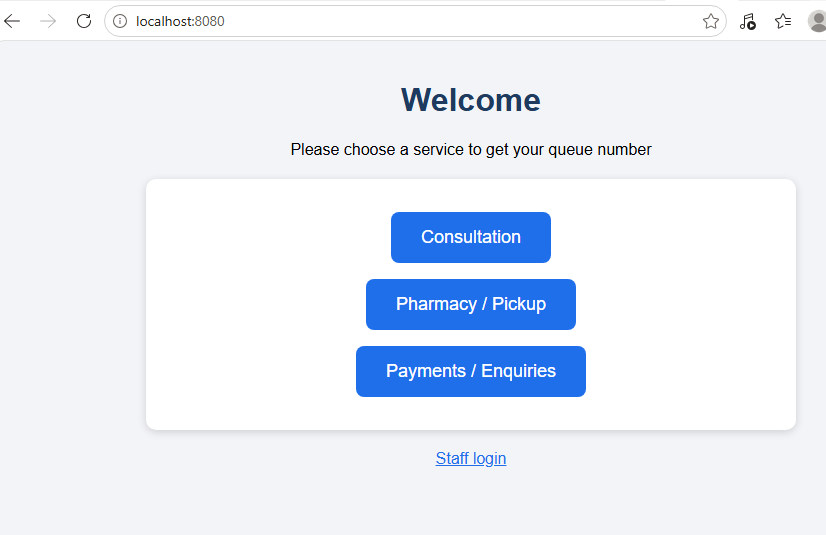
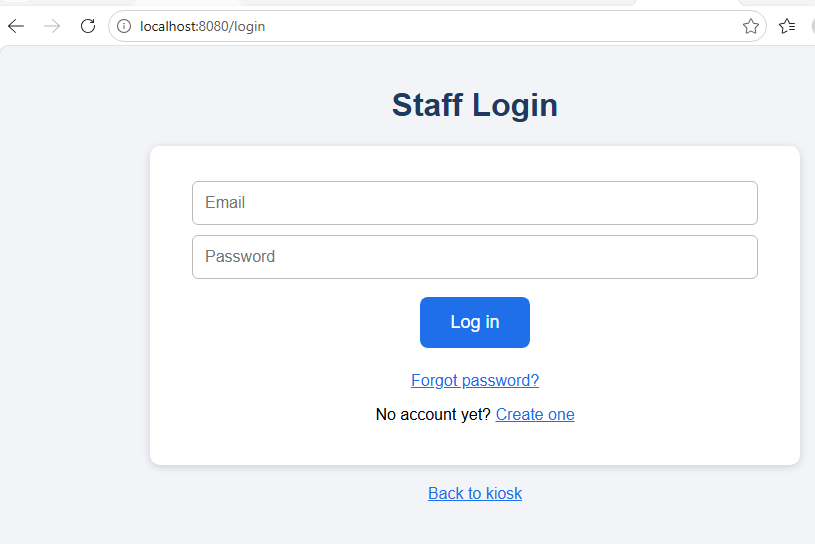
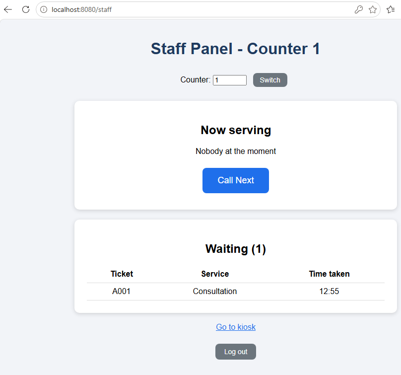
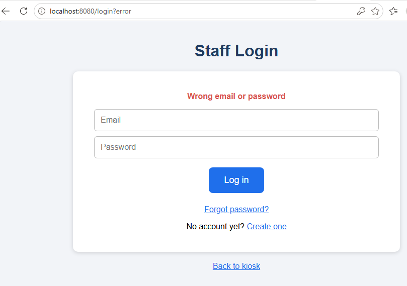
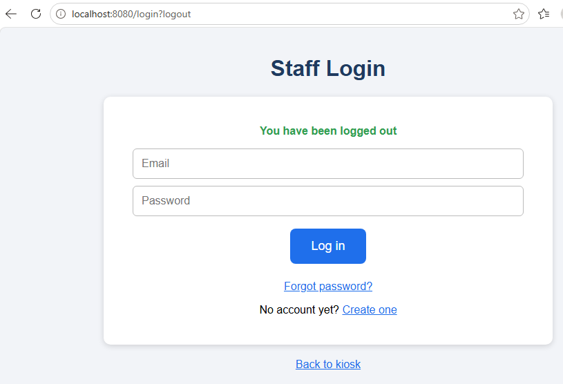
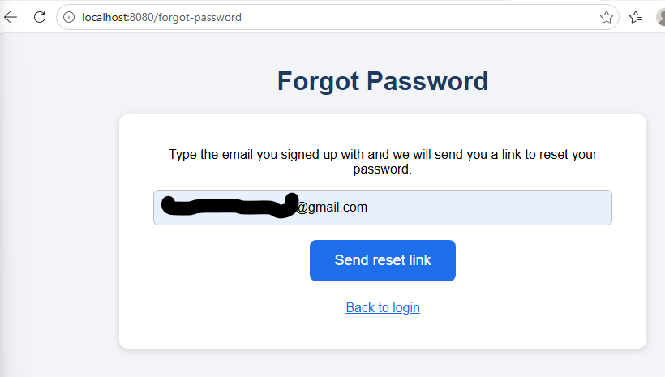
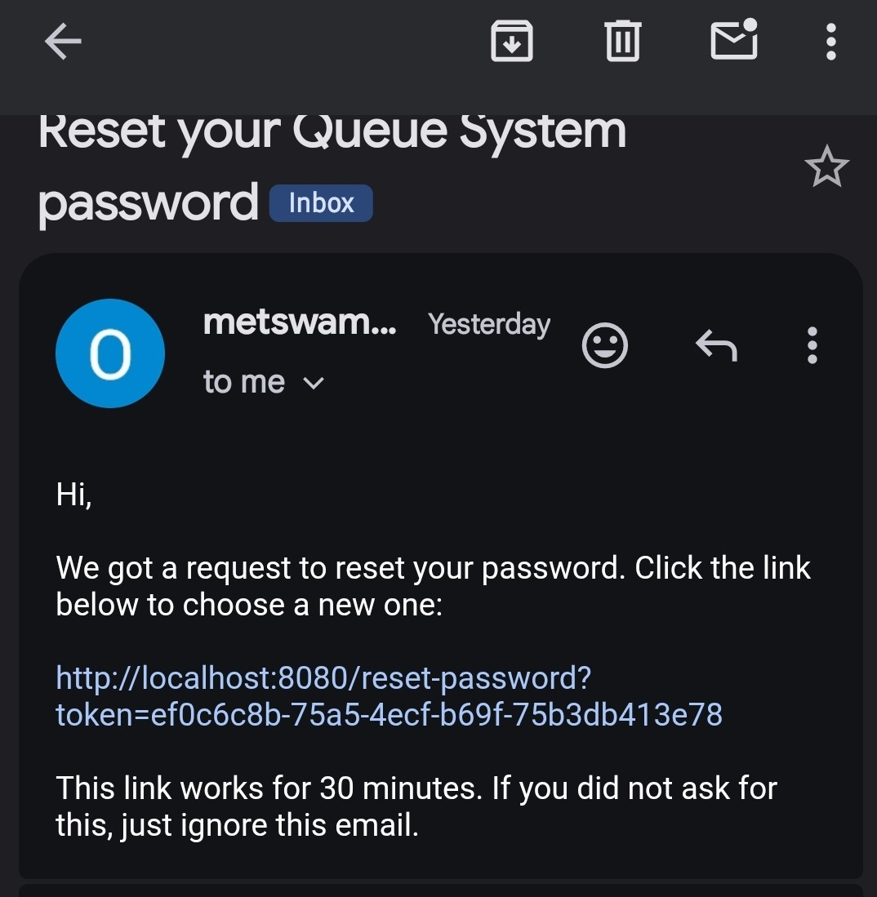

# Queue Management System

A web-based queue system for clinics, fast food shops, banks and any business where customers wait in line.
Customers take a ticket at a kiosk, and staff call people from their counter. Staff accounts are protected
by login, with register and forgot-password (email reset) features.

**Built with:** Java 21, Spring Boot 3, Spring MVC, Spring Data JPA (Hibernate), Spring Security, Thymeleaf, MySQL, Maven

## Screenshots

| Kiosk | Staff login |
|-------|-------------|
|  |  |

| Staff panel | Wrong password |
|-------------|----------------|
|  |  |

| Logged out | Password reset |
|------------|----------------|
|  |  |

| Reset email |
|-------------|
|  |

## Features

**Customers (no login needed)**
- Pick a service at the kiosk and get a ticket number like `A001` (numbers restart every day)
- Ticket page shows how many people are ahead and refreshes by itself
- When called, the ticket tells the customer which counter to go to

**Staff (login required)**
- Create an account, log in and log out
- Forgot password: a reset link is emailed through Gmail (link expires after 30 minutes and works once)
- Staff panel per counter: Call Next, Done, Skip (no show)
- Live list of waiting tickets

**Security**
- Spring Security protects the staff pages
- Passwords are hashed with BCrypt, never stored as plain text
- Reset tokens are random, expire and can only be used once
- The forgot-password page gives the same message whether or not an email exists

## How it works

1. Customer opens `/` and picks a service, and a ticket is saved with status `WAITING`
2. Staff open `/staff?counter=1` and press **Call Next**, and the oldest waiting ticket becomes `SERVING`
3. Staff press **Done** (`DONE`) or **Skip** (`SKIPPED`)

## Project structure